# Applied Statistical Investigations: MTH 119 Capstone Report

**Author:** Robert Thomas Kohn  
**Course:** MTH 119 (Statistical Analysis), Muhlenberg College  
**Computing Environment:** R (v4.4+) with `mosaic`, `lattice`, and `Lock5Data`

---

## Executive Summary

This report compiles four empirical statistical investigations applying classical inference, variance testing, and linear regression to real-world datasets:

1. **Categorical vs. Categorical:** A Pearson's $\chi^2$ test of independence evaluating drug dependency profiles and housing stability among clinical detoxification patients (`HELPrct`).
2. **Quantitative vs. Categorical (ANOVA):** A one-way Analysis of Variance testing whether table bill amounts differ significantly across restaurant servers (`RestaurantTips`), accompanied by variance ratio and normality assumption checks.
3. **Quantitative vs. Categorical (Two-Sample $t$-Test):** A Welch two-sample $t$-test and 95% confidence interval investigating commute time differences between carbon fiber and steel bicycle frames (`BikeCommute`).
4. **Quantitative vs. Quantitative (Simple Linear Regression):** An Ordinary Least Squares (OLS) bivariate regression modeling regular season Major League Baseball team wins as a function of Runs Batted In (`BaseballHits2019`).

---

## 1. Categorical vs. Categorical: Substance Choice and Housing Status

### Research Question
For patients admitted to a clinical detoxification unit, is there a statistically significant association between their primary substance of abuse and their housing status?

### Dataset
- **Data Source:** `HELPrct` (Health Evaluation and Linkage to Primary Care trial)
- **Sample Size:** $n = 453$ adult patients
- **Variables Analyzed:**
  - `substance` (Categorical, 3 levels): Primary substance of abuse (`alcohol`, `cocaine`, `heroin`)
  - `homeless` (Categorical, 2 levels): Housing status (`homeless`, `housed`)

### Numerical Summary & Observations
A two-way contingency table cross-tabulating substance choice by housing status reveals clear conditional distributional differences:

| Substance | Homeless ($n$) | Housed ($n$) | Total ($n$) | Homeless Proportion ($\hat{p}$) | Housed Proportion |
| :--- | :---: | :---: | :---: | :---: | :---: |
| **Alcohol** | 103 | 74 | 177 | **0.582** | 0.418 |
| **Cocaine** | 59 | 93 | 152 | **0.388** | 0.612 |
| **Heroin** | 47 | 77 | 124 | **0.379** | 0.621 |
| **Total** | 209 | 244 | 453 | 0.461 | 0.539 |

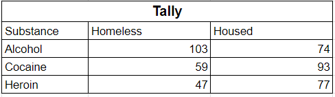

**Descriptive Observation:** A disproportionate percentage of alcohol-dependent individuals in the detoxification unit are homeless ($\hat{p}_a \approx 0.58$), compared to cocaine ($\hat{p}_c \approx 0.39$) and heroin ($\hat{p}_h \approx 0.38$) users, who are more predominantly housed.

### Hypothesis Test: $\chi^2$ Test of Independence
To evaluate whether this observed difference is statistically significant, a Pearson's Chi-squared test of independence was performed:

- **Null Hypothesis ($H_0$):** Primary substance choice and housing status are independent among detoxification unit patients.
- **Alternative Hypothesis ($H_a$):** Primary substance choice and housing status are not independent.
- **Significance Level:** $\alpha = 0.05$

#### Test Results:
- **Chi-Square Statistic:** $\chi^2 = 17.012$
- **Degrees of Freedom:** $\text{df} = (3 - 1)(2 - 1) = 2$
- **$p$-Value:** $p = 0.000202$

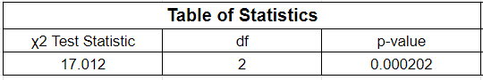

```r
# R Code
tally_counts <- tally(substance ~ homeless, data = HELPrct)
xchisq.test(tally_counts)
```

### Conclusion
Because the $p$-value ($0.000202$) is far below the threshold $\alpha = 0.05$, we reject the null hypothesis. There is strong, statistically significant evidence that primary substance choice and housing status are dependent among patients in the detoxification unit. Specifically, patients presenting with alcohol dependency are significantly more likely to be homeless, whereas patients reporting primary cocaine or heroin use are more frequently housed.

---

## 2. Quantitative vs. Categorical I: Server Effect on Restaurant Bill Size

### Research Question
Is there a statistically significant difference in mean customer bill amounts across different servers at a dining establishment?

### Dataset
- **Data Source:** `RestaurantTips`
- **Sample Size:** $n = 157$ customer tables
- **Variables Analyzed:**
  - `Server` (Categorical, Explanatory): Server identifier (`A`, `B`, `C`)
  - `Bill` (Quantitative, Response): Table bill amount in US dollars

### Numerical Summary & Group Statistics

| Server | Sample Size ($n$) | Mean ($\bar{x}$) | Std Dev ($s$) | Min | $Q_1$ | Median | $Q_3$ | Max |
| :---: | :---: | :---: | :---: | :---: | :---: | :---: | :---: | :---: |
| **A** | 60 | $\$22.76$ | $\$12.71$ | $\$1.66$ | $\$14.42$ | $\$19.56$ | $\$29.16$ | $\$70.51$ |
| **B** | 65 | $\$21.14$ | $\$10.19$ | $\$3.75$ | $\$14.87$ | $\$18.83$ | $\$26.80$ | $\$59.33$ |
| **C** | 32 | $\$25.92$ | $\$14.35$ | $\$3.26$ | $\$18.06$ | $\$23.19$ | $\$32.57$ | $\$57.30$ |

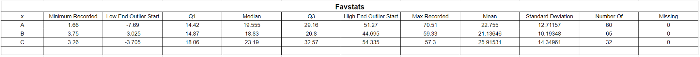

**Descriptive Observation:** Server C exhibits a slightly higher sample mean bill ($\$25.92$) relative to Server A ($\$22.76$) and Server B ($\$21.14$), but the distributions show substantial overlap and right-skewness.

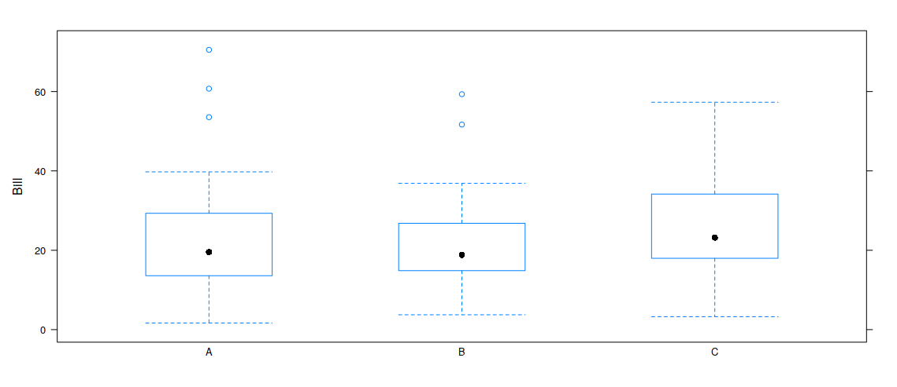

### Assumption Checks
1. **Sample Size & Normality:** Each server group contains $n \ge 30$ observations (Server A: 60, Server B: 65, Server C: 32). While raw bill distributions display slight right-skewness typical of monetary dining tabs, normal quantile-quantile plots (Q-Q plots) confirm the central distributions behave reasonably well, and the large group sample sizes ($n \ge 30$) satisfy Central Limit Theorem conditions for ANOVA robustness.
2. **Homoscedasticity (Equal Variance):** The largest group standard deviation ($s_C = 14.35$) is well below twice the smallest standard deviation ($s_B = 10.19$):
   $$\frac{s_{\max}}{s_{\min}} = \frac{14.35}{10.19} \approx 1.41 < 2.0$$
   This satisfies the standard rule of thumb for assuming approximately equal population variances.

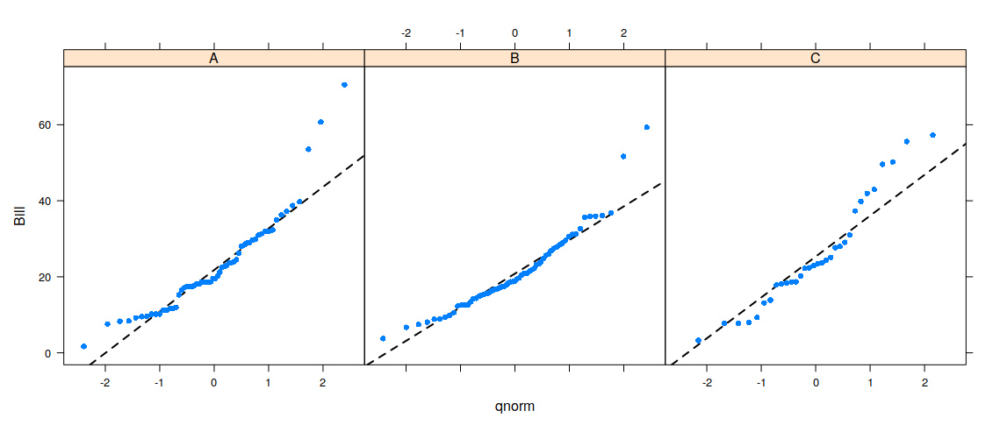

### Hypothesis Test: One-Way ANOVA
- **Null Hypothesis ($H_0$):** $\mu_A = \mu_B = \mu_C$ (The population mean bill amounts are identical across all three servers).
- **Alternative Hypothesis ($H_a$):** At least one server's population mean bill amount is different.
- **Significance Level:** $\alpha = 0.05$

#### ANOVA Table:
| Source | Degrees of Freedom ($\text{df}$) | Sum of Squares ($\text{SS}$) | Mean Square ($\text{MS}$) | $F$-Statistic | $p$-Value |
| :--- | :---: | :---: | :---: | :---: | :---: |
| **Server (Between)** | 2 | 490 | 244.9 | **1.671** | **0.191** |
| **Residuals (Within)** | 154 | 22,567 | 146.5 | | |
| **Total** | 156 | 23,057 | | | |

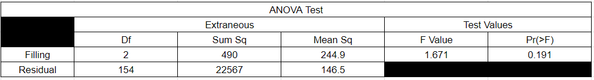

```r
# R Code
aov_tips <- aov(Bill ~ Server, data = RestaurantTips)
summary(aov_tips)
```

### Conclusion
With an $F$-statistic of $1.671$ and a $p$-value of $0.191$, which exceeds $\alpha = 0.05$, we fail to reject the null hypothesis. There is insufficient evidence to conclude that mean customer bill sizes differ significantly based on which server attends the table.

---

## 3. Quantitative vs. Categorical II: Commuting Time by Bicycle Frame Material

### Research Question
Are mean commuting travel times different depending on whether a carbon fiber or steel frame bicycle is used?

### Dataset
- **Data Source:** `BikeCommute`
- **Sample Size:** $n = 56$ recorded bike commutes
- **Variables Analyzed:**
  - `Bike` (Categorical, Explanatory, 2 levels): Bicycle frame material (`Carbon`, `Steel`)
  - `Minutes` (Quantitative, Response): Commute duration in minutes

### Numerical Summary & Group Statistics

| Bike Frame | Sample Size ($n$) | Mean ($\bar{x}$) | Std Dev ($s$) | Min | $Q_1$ | Median | $Q_3$ | Max |
| :---: | :---: | :---: | :---: | :---: | :---: | :---: | :---: | :---: |
| **Carbon** | 26 | 108.34 min | 6.25 min | 100.08 | 102.79 | 107.71 | 112.48 | 123.33 |
| **Steel** | 30 | 107.79 min | 4.86 min | 97.67 | 104.68 | 107.54 | 111.25 | 117.73 |

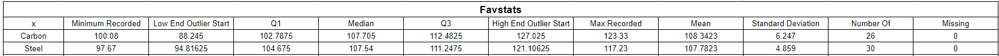

**Descriptive Observation:** The sample mean commute time on a carbon frame ($108.34$ min) is less than one minute faster/slower than on a steel frame ($107.79$ min), indicating very minimal practical difference.

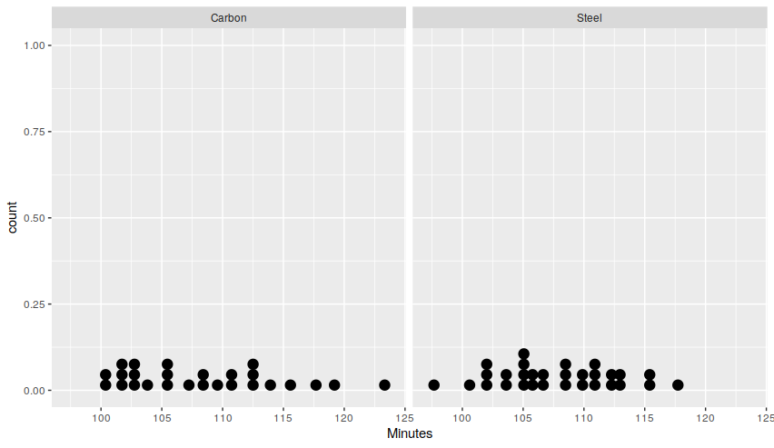
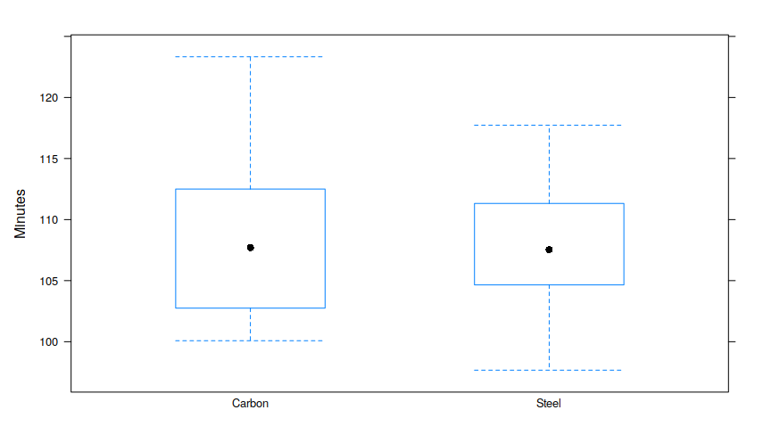

### Assumption Checks
1. **Continuous & Random:** Commute duration is continuous and represents repeated commute trials sampled across comparable routes.
2. **Normality:** Normal quantile plots (Q-Q plots) show points lining up closely along the theoretical diagonal with no severe outliers, confirming that the sample distributions for both groups are approximately normal.
3. **Variance Comparison:** Group standard deviations ($6.25$ vs. $4.86$) are comparable. Welch's $t$-test is applied, which does not require pooled variance assumptions.

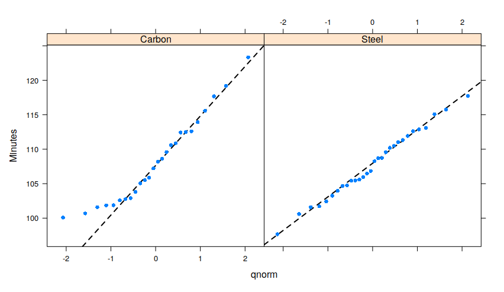

### Hypothesis Test & Confidence Interval: Welch Two-Sample $t$-Test
- **Null Hypothesis ($H_0$):** $\mu_{\text{carbon}} - \mu_{\text{steel}} = 0$ (Mean commute time is identical across bike frames).
- **Alternative Hypothesis ($H_a$):** $\mu_{\text{carbon}} - \mu_{\text{steel}} \ne 0$
- **Significance Level:** $\alpha = 0.05$

#### Test Results:
- **Welch $t$-Statistic:** $t = 0.36556$
- **Degrees of Freedom:** $\text{df} = 46.962$
- **$p$-Value:** $p = 0.7163$
- **95% Confidence Interval for $\mu_{\text{carbon}} - \mu_{\text{steel}}$:**
  $$[-2.490, 3.596] \text{ minutes}$$

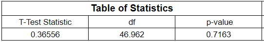

```r
# R Code
t.test(Minutes ~ Bike, data = BikeCommute)
```

### Conclusion
Because the $p$-value ($0.7163$) is substantially larger than $\alpha = 0.05$, we fail to reject the null hypothesis. There is not sufficient evidence to conclude that bicycle frame material (carbon vs. steel) produces a difference in mean commute travel time. Furthermore, we can state with 95% confidence that the true difference in mean commute time between carbon and steel frames falls between $-2.49$ and $+3.60$ minutes—an interval tightly centered near zero.

---

## 4. Quantitative vs. Quantitative: MLB Team Wins and Runs Batted In (RBIs)

### Research Question
What is the nature and strength of the linear relationship between regular season Major League Baseball team wins and Runs Batted In (RBIs)?

### Dataset
- **Data Source:** `BaseballHits2019`
- **Sample Size:** $n = 30$ Major League Baseball teams (2019 season)
- **Variables Analyzed:**
  - `RBI` (Quantitative, Explanatory): Total team Runs Batted In
  - `Wins` (Quantitative, Response): Total regular season team wins

### Numerical Summary & Correlation
- **Sample Correlation:** $r = 0.8173 \approx 0.818$
- **Coefficient of Determination:** $R^2 = 0.6680 \approx 66.8\%$

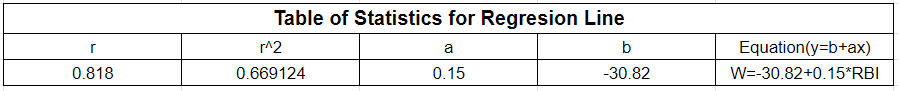

**Descriptive Observation:** The scatterplot exhibits a strong, positive, linear relationship between team RBIs and total wins. Teams producing more RBIs consistently achieved higher victory totals.

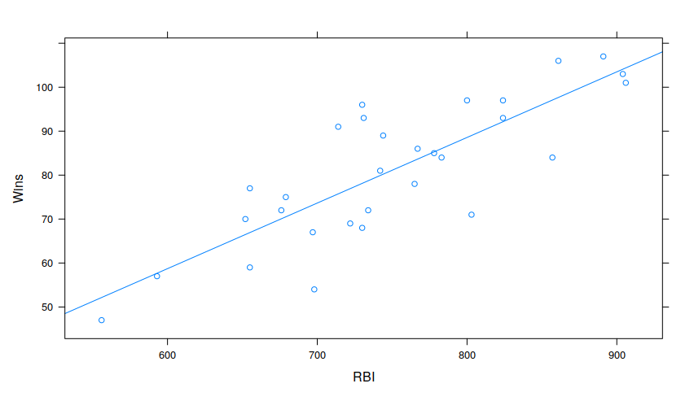

### Linear Regression Model
Fitting an Ordinary Least Squares (OLS) regression line yields:
$$\widehat{\text{Wins}} = -30.818 + 0.1492 \times \text{RBI}$$

| Term | Estimate ($\hat{\beta}$) | Std. Error | $t$-Statistic | $p$-Value |
| :--- | :---: | :---: | :---: | :---: |
| **Intercept ($\beta_0$)** | $-30.818$ | $14.988$ | $-2.056$ | $0.0492$ |
| **Slope ($\beta_1$, RBI)** | $+0.1492$ | $0.0199$ | **$+7.507$** | **$3.55 \times 10^{-8}$** |

- **Residual Standard Error:** $s_e = 9.323$ on $\text{df} = 28$
- **Model $F$-Statistic:** $F(1, 28) = 56.35, p = 3.55 \times 10^{-8}$

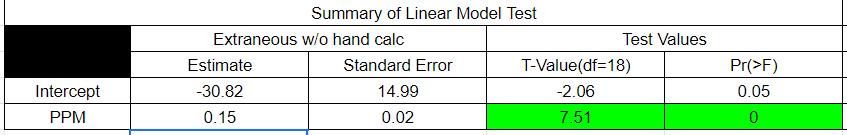

```r
# R Code
lm_base <- lm(Wins ~ RBI, data = BaseballHits2019)
summary(lm_base)
```

### Hypothesis Tests: Population Correlation and Slope
- **Zero Correlation Test:**
  - $H_0: \rho = 0$ vs. $H_a: \rho \ne 0$
- **Zero Slope Test:**
  - $H_0: \beta_1 = 0$ vs. $H_a: \beta_1 \ne 0$
- **Test Statistic:** $t = 7.507$ ($\text{df} = 28$), $p = 3.55 \times 10^{-8} < 0.001$

### Conclusion
We have highly significant evidence ($p < 0.001$) to reject the null hypothesis that the true population correlation ($\rho$) and slope ($\beta_1$) between MLB team wins and RBIs are zero. 

**Substantive Interpretation:**
- **Slope:** For each additional Run Batted In over the course of a season, a team is expected to gain on average approximately $0.15$ additional wins (or approximately $1$ additional win for every $\approx 6.7$ RBIs).
- **$R^2$:** Approximately $66.8\%$ of the total variability in 2019 MLB regular season team wins is explained by team RBIs via this linear model.

---

## Technical & Reproducibility Notes
All computations in this project were verified using R version 4.4.2 under Windows x86_64. The full reproduction script is provided in [`analysis.R`](analysis.R).
