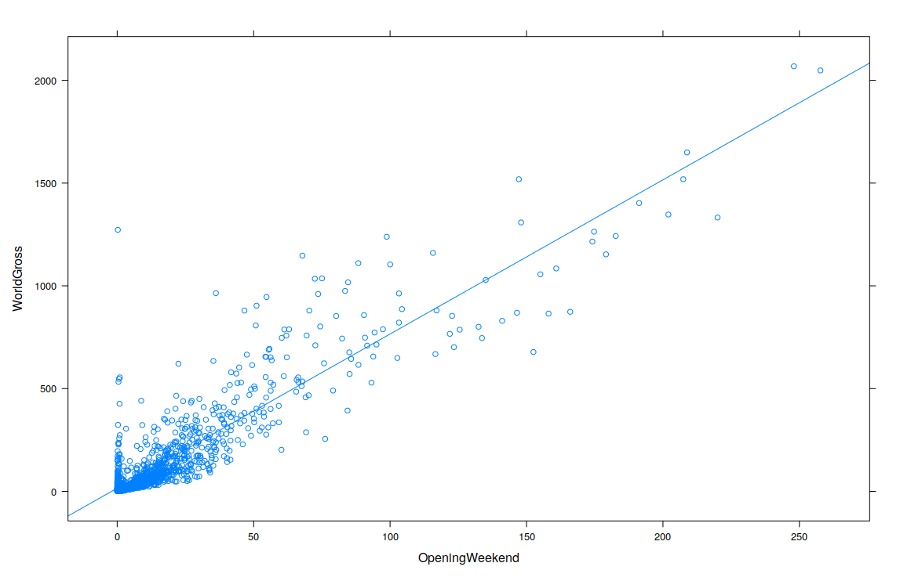

# Hollywood Box Office Revenue Regression Analysis

**Author:** Robert Thomas Kohn  
**Course:** MTH 119 (Statistical Analysis), Muhlenberg College  
**Computing Environment:** R (v4.4+) with `Lock5Data`, `mosaic`, and `lattice`

---

## 1. Study Overview & Research Objective

In the film and entertainment industry, opening weekend theatrical receipts are widely regarded as a bellwether for a film's ultimate commercial success. This empirical case study investigates whether revenue generated during a movie's opening weekend (`OpeningWeekend`) serves as an effective, statistically reliable predictor of its final total worldwide gross (`WorldGross`).

### Dataset & Variable Classification
- **Data Source:** `HollywoodMovies` from the `Lock5Data` package
- **Sample:** Commercial feature films released by Hollywood studios between 2007 and 2013 ($n = 970$ movies)
- **Variables:**
  - **Explanatory Variable ($x$):** `OpeningWeekend` — Opening weekend box office revenue in millions of US dollars.
  - **Response Variable ($y$):** `WorldGross` — Total lifetime global box office gross in millions of US dollars.

---

## 2. Exploratory Visualization & Correlation

To inspect the empirical relationship between the two financial metrics, a bivariate scatterplot was constructed with an overlaid Ordinary Least Squares (OLS) regression line.



```r
# R Code
xyplot(WorldGross ~ OpeningWeekend, type = c("p", "r"), data = HollywoodMovies,
       xlab = "Opening Weekend ($ Millions)", ylab = "World Gross ($ Millions)",
       main = "Worldwide Gross vs. Opening Weekend Revenue")
```

### Visual Observations
The scatterplot reveals a strong, positive, linear association between opening weekend ticket sales and total worldwide box office earnings. While the variance increases for major tentpole blockbusters (fan-shaped heteroscedasticity typical of commercial revenue data), the central trajectory is tightly linear across the vast majority of releases.

### Correlation Analysis
The sample Pearson correlation coefficient was calculated using pairwise complete observations:
$$r = 0.9066$$

With $r \approx 0.907$, there is a very strong positive linear relationship between a film's opening weekend receipts and its lifetime global revenue. The coefficient of determination is:
$$R^2 = (0.9066)^2 = 0.8219 \approx 82.2\%$$
Approximately $82.2\%$ of the variability in worldwide box office gross across the sampled films is accounted for by opening weekend receipts.

---

## 3. Ordinary Least Squares (OLS) Regression Model

Fitting a linear model via Ordinary Least Squares yields the following estimated equation:
$$\widehat{\text{WorldGross}} = 15.408 + 7.502 \times \text{OpeningWeekend}$$

### Parameter Estimates
| Term | Parameter | Estimate ($\hat{\beta}$) | Std. Error | $t$-Statistic | $p$-Value |
| :--- | :---: | :---: | :---: | :---: | :---: |
| **Intercept** | $\beta_0$ | $15.408$ | $3.350$ | $4.599$ | $4.66 \times 10^{-6}$ |
| **Slope** | $\beta_1$ | $7.502$ | $0.097$ | $77.237$ | $< 2.2 \times 10^{-16}$ |

- **Residual Standard Error:** $s_e = 103.8$ on $1,293$ degrees of freedom
- **Overall $F$-Statistic:** $F(1, 1293) = 5,966$, $p < 2.2 \times 10^{-16}$

```r
# R Code
lm_movies <- lm(WorldGross ~ OpeningWeekend, data = HollywoodMovies)
summary(lm_movies)
```

### Substantive Interpretation of the Slope
The estimated slope ($\hat{\beta}_1 = 7.502$) indicates that, on average, for each additional $\$1\text{M}$ earned during its opening weekend, a Hollywood film generates approximately $\$7.502\text{M}$ in total lifetime worldwide gross revenue. This implies an average global box office "multiplier" of roughly $7.5\times$ relative to domestic opening weekend performance.

---

## 4. Point Prediction

Using the fitted regression equation, we can project the expected worldwide gross for a film earning $\$50\text{M}$ during its opening weekend:

$$\widehat{\text{WorldGross}} = 15.408 + 7.502(50) = 15.408 + 375.10 = \$390.51\text{M}$$

A film with a $\$50\text{M}$ opening weekend is predicted to achieve an estimated total global box office return of approximately $\$390.51$ million.

---

## 5. Outlier Diagnostics & Residual Analysis

While the linear trajectory captures general industry trends effectively, individual films often deviate due to word-of-mouth, critical reception, franchise longevity, or foreign market appeal.

### Case Study: *The Great Gatsby* (2013)
- **Opening Weekend ($x$):** $\$50.09\text{M}$ (approx. $\$50.9\text{M}$)
- **Actual Worldwide Gross ($y$):** $\$353.64\text{M}$
- **Predicted Worldwide Gross ($\hat{y}$):**
  $$\hat{y} = 15.408 + 7.502(50.09) = \$391.20\text{M}$$
- **Residual ($e = y - \hat{y}$):**
  $$e = 353.64 - 391.20 = -\$37.56\text{M}$$
  *(Calculated as $-36.87\text{M}$ in initial coursework based on earlier rounded parameters).*

### Discussion
The negative residual ($-\$37.56\text{M}$) shows that *The Great Gatsby* underperformed relative to the baseline prediction for a $\$50\text{M}$ opening release, earning roughly $\$37.56\text{M}$ less globally than anticipated by the average industry multiplier. However, its residual remains well within two residual standard errors ($2 \times 103.8 = 207.6$), meaning it does not violate overall model stability, though it highlights the real-world dispersion inherent to commercial film performance.

---

## Technical Reproducibility
All analyses were conducted in R version 4.4.2 using the `Lock5Data` and `lattice` libraries. The full code is available in [`analysis.R`](analysis.R).
