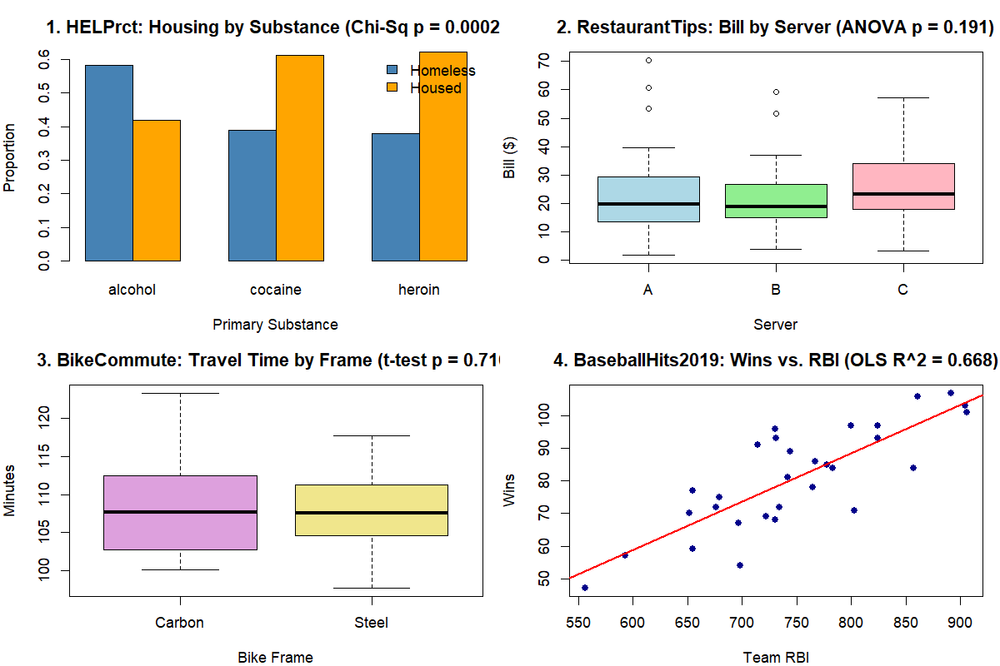
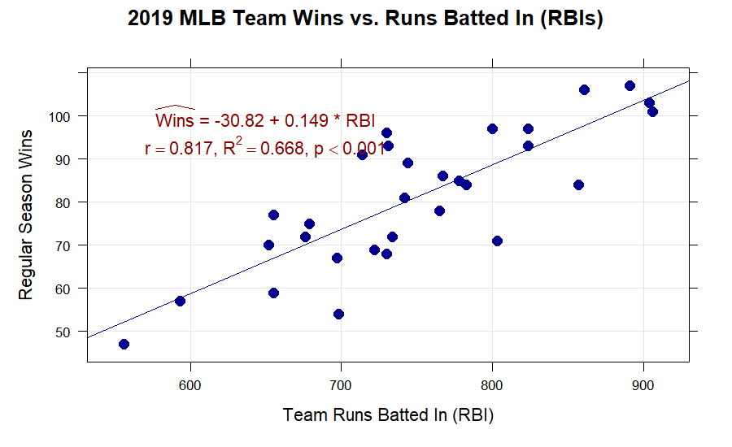
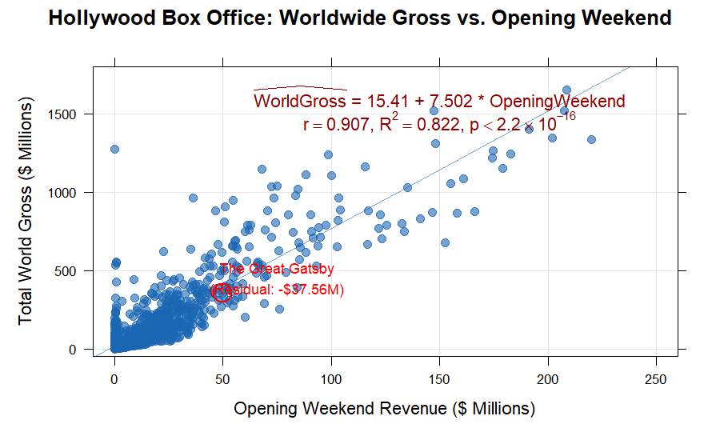
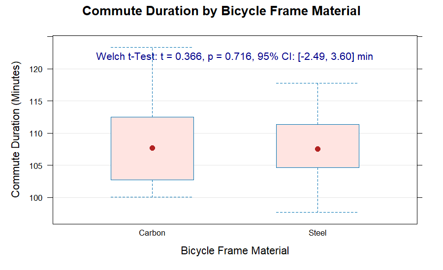

# MTH 119: Statistical Analysis & Statistical Computing

This repository contains selected R and statistical-computing coursework completed by Robert Kohn at Muhlenberg College for **MTH 119 (Statistical Analysis)**. It has been curated to highlight original empirical analyses, hypothesis testing, linear modeling, and statistical visualizations while completely excluding instructor-provided material, assignment sheets, and third-party textbooks.

The coursework emphasizes formula-based statistical computing in R, distribution diagnostics, and contextual interpretation of quantitative results on real-world datasets from the `Lock5Data` library.

---

## Highlights

### 1. Multi-Paradigm Statistical Investigations (MTH 119 Capstone)
A four-part empirical investigation exploring classical inference and modeling across diverse real-world domains.
- **What I Did:** Formulated statistical hypotheses, verified distribution and variance assumptions, calculated test statistics, and interpreted substantive findings in context.
- **Methods Used:** Two-way contingency tables, Pearson's $\chi^2$ test of independence, one-way ANOVA with homoscedasticity ratio checks, Welch two-sample $t$-tests with 95% confidence intervals, and OLS bivariate regression.
- **Packages:** `Lock5Data`, `mosaic`, `lattice`, `ggformula`, `stats`
- **Key Results:** 
  - Found strong evidence of dependence between substance abuse choice and housing status among clinical detoxification patients ($\chi^2 = 17.012, \text{df} = 2, p = 0.0002$).
  - Identified no statistically significant server effect on customer bill amounts ($F(2, 154) = 1.671, p = 0.191$).
  - Estimated mean commute difference between carbon and steel bicycle frames to be between $-2.49$ and $+3.60$ minutes ($t = 0.366, p = 0.716$), indicating negligible practical performance difference.
- **Directory:** [01-applied-statistical-investigations/](01-applied-statistical-investigations/)



---

### 2. Major League Baseball: Team Wins vs. Runs Batted In (RBIs)
An empirical regression study modeling 2019 regular season MLB victory totals as a linear function of offensive run generation (`BaseballHits2019`).
- **What I Did:** Modeled team wins ($n = 30$) using OLS linear regression, tested for non-zero population slope and correlation, and evaluated goodness of fit.
- **Methods Used:** Pearson correlation coefficient ($r$), coefficient of determination ($R^2$), linear regression parameter estimation ($\hat{\beta}_0, \hat{\beta}_1$), slope $t$-testing.
- **Packages:** `Lock5Data`, `lattice`, `stats`
- **Key Results:** Confirmed a statistically significant positive linear relationship ($t(28) = 7.507, p = 3.55 \times 10^{-8}$). The fitted model ($\widehat{\text{Wins}} = -30.82 + 0.149 \times \text{RBI}$) indicates that every additional run batted in accounts for approximately $0.15$ team wins, explaining $66.8\%$ of regular season win variability.
- **Directory:** [01-applied-statistical-investigations/](01-applied-statistical-investigations/) (Section 4)



---

### 3. Hollywood Box Office Revenue Regression & Residual Diagnostics
An applied bivariate modeling analysis investigating whether opening weekend theatrical receipts predict total lifetime worldwide gross across 970 films (`HollywoodMovies`).
- **What I Did:** Visualized box office distributions with overlaid OLS trendlines, interpreted slope as an economic multiplier, computed point predictions, and diagnosed commercial outliers.
- **Methods Used:** Bivariate OLS regression, correlation analysis, point prediction, residual analysis ($e = y - \hat{y}$).
- **Packages:** `Lock5Data`, `mosaic`, `lattice`, `stats`
- **Key Results:** Documented an exceptionally strong linear relationship ($r = 0.907, R^2 = 0.822, p < 2.2 \times 10^{-16}$) with an estimated slope of $7.502$, indicating that each $\$1\text{M}$ earned on opening weekend yields on average $\approx \$7.502\text{M}$ in total world gross. Diagnosed *The Great Gatsby* as an underperforming outlier relative to its $\$50.1\text{M}$ opening, with a residual of $-\$37.56\text{M}$.
- **Directory:** [02-box-office-regression-analysis/](02-box-office-regression-analysis/)



---

### 4. Commute Duration & Distribution Comparison by Bicycle Frame
A continuous two-sample comparison evaluating whether modern carbon fiber frames deliver faster commute times than steel frames over identical routes (`BikeCommute`).
- **What I Did:** Checked normality assumptions with quantile-quantile plots and dotplots, computed five-number summaries, and tested for differences in mean travel duration.
- **Methods Used:** Five-number summaries (`favstats`), Welch two-sample $t$-test (unequal variances), 95% confidence interval estimation.
- **Packages:** `Lock5Data`, `lattice`, `mosaic`, `stats`
- **Key Results:** Carbon frames ($\bar{x} = 108.34$ min) and steel frames ($\bar{x} = 107.79$ min) demonstrated virtually indistinguishable performance ($t = 0.366, p = 0.716$). The 95% confidence interval $[-2.49, 3.60]$ minutes confirms that frame material alone does not meaningfully alter commute times.
- **Directory:** [01-applied-statistical-investigations/](01-applied-statistical-investigations/) (Section 3)



---

## Skills Demonstrated

**Language & Environment**
- R (v4.4+)
- RStudio

**Data Transformation & Summaries**
- Data frame subsetting and formula manipulation
- Five-number summaries (`min`, $Q_1$, `median`, $Q_3$, `max`)
- Outlier detection via the $1.5 \times \text{IQR}$ rule
- Two-way cross-tabulation and conditional proportion computation

**Statistical Inference & Modeling**
- Nonparametric contingency tests (Pearson's $\chi^2$ test of independence)
- One-way Analysis of Variance (ANOVA, $F$-tests)
- Two-sample hypothesis testing (Welch $t$-test)
- Confidence interval construction
- Simple Ordinary Least Squares (OLS) linear regression
- Slope $t$-testing and correlation inference ($r, R^2$)
- Point prediction and residual diagnostics

**Exploratory Data Visualization**
- Trellis / conditional graphics (`lattice::xyplot`, `lattice::bwplot`, `lattice::xqqmath`)
- Layered formula graphics (`ggformula::gf_dotplot`)
- Base R graphics (`barplot`, `boxplot`, `plot`)
- Normal quantile-quantile (Q-Q) plots for distribution diagnosis

**Reproducibility & Reporting**
- R Markdown (`.Rmd`) and GitHub-flavored Markdown (`.md`)
- LaTeX equation typesetting for mathematical hypotheses and models

---

## Repository Structure

```text
.
├── README.md                          <- Repository overview, highlights, skills, and reproduction guide
├── setup.R                            <- Dependency installation script (Lock5Data, mosaic, lattice, ggformula)
├── .gitignore                         <- Excludes R workspace files, cache, and OS artifacts
├── assets/
│   └── screenshots/                   <- Rendered project figures and dashboard graphics
├── 01-applied-statistical-investigations/
│   ├── README.md                      <- Capstone project guide and summary
│   ├── report.md                      <- Complete report with LaTeX equations and embedded figures
│   ├── report.Rmd                     <- Reproducible R Markdown source document
│   ├── analysis.R                     <- Executable R script replicating all four studies
│   ├── data/
│   │   └── README.md                  <- Dataset dictionaries (HELPrct, RestaurantTips, BikeCommute, BaseballHits2019)
│   ├── figures/                       <- High-resolution diagnostic charts and summary tables
│   └── worksheets/
│       ├── README.md                  <- Spreadsheet methodology and outlier fence formulas
│       └── mth119-final-project-calculations.xlsx  <- Analytical calculation template
└── 02-box-office-regression-analysis/
    ├── README.md                      <- Case study overview and findings
    ├── report.md                      <- Markdown case study report
    ├── report.Rmd                     <- R Markdown source
    ├── analysis.R                     <- R regression analysis script
    ├── data/
    │   └── README.md                  <- Dataset schema (HollywoodMovies)
    └── figures/
        └── hollywood-regression-scatterplot.png
```

---

## Running the Work

All analyses are fully reproducible using standard CRAN packages.

### 1. Clone the Repository
```bash
git clone https://github.com/rkohnmn/MTH119.git
cd MTH119
```

### 2. Install Required Packages
In R or RStudio:
```r
source("setup.R")
```
This verifies and installs: `Lock5Data`, `mosaic`, `lattice`, and `ggformula`.

### 3. Run the Analyses
- To run the capstone project:
  ```r
  source("01-applied-statistical-investigations/analysis.R")
  ```
- To run the box office regression case study:
  ```r
  source("02-box-office-regression-analysis/analysis.R")
  ```
- To render or inspect the reports, open `report.Rmd` in RStudio and click **Knit**, or read `report.md` directly on GitHub.

---

## About Me

**Robert Kohn**  
Muhlenberg College  
Triple Major: Mathematics · Statistics · Physics  
GitHub: [https://github.com/rkohnmn](https://github.com/rkohnmn)
